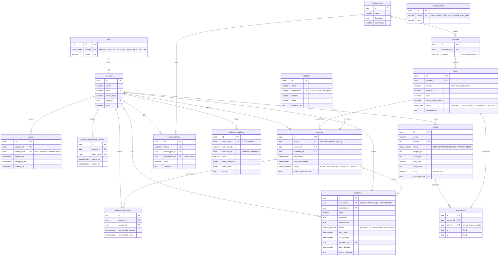

# Banco de dados

PostgreSQL 17 acessado pelo **Prisma ORM 7** com o driver adapter `@prisma/adapter-pg`.

| Arquivo | Papel |
| --- | --- |
| `prisma/schema.prisma` | schema único com todos os models (um arquivo para o monolito) |
| `prisma/migrations/` | migrations versionadas |
| `prisma7.config.ts` | configuração do Prisma CLI (schema, migrations, `DATABASE_URL`) |
| `src/generated/prisma/` | Prisma Client gerado por `npm run db:generate` (não versionado, não editar) |
| `src/shared/infra/database/` | `PrismaService`, `PrismaModule` (global), `TransactionManager`, `PrismaTransaction` |

O Prisma Client é importado de `src/generated/prisma/client.js`, nunca de `@prisma/client`.

## Organização do schema

- Os models ficam agrupados por módulo, na ordem do [mapa de módulos](architecture.md#mapa-de-módulos), com um comentário de seção: `// ===== reservas =====`.
- Cada model pertence a um único módulo (ver mapa). Relações entre models de módulos diferentes são permitidas no schema (chaves estrangeiras garantem integridade), mas o código de um módulo não escreve nas tabelas de outro.
- O diagrama ER fica neste arquivo, na seção [Diagrama ER](#diagrama-er), em Mermaid, e é atualizado no mesmo PR que alterar o schema.

## Padrões de modelagem

### Chave primária

Toda tabela usa uuid:

```prisma
id String @id @default(uuid()) @db.Uuid
```

O id é gerado pela entidade em `create()` (`randomUUID()` de `node:crypto`) e enviado pelo repositório no `create`. O `@default(uuid())` é só uma garantia para inserts fora da aplicação (seed, SQL manual). Chaves estrangeiras também são `String @db.Uuid`.

### Timestamps

Toda tabela tem:

```prisma
createdAt DateTime @default(now()) @map("created_at") @db.Timestamptz(3)
updatedAt DateTime @updatedAt @map("updated_at") @db.Timestamptz(3)
```

Exceção: tabelas só de inserção (ex.: `HistoricoAuditoria`, `ReservaRenovacao`) têm só `createdAt`. Datas de negócio (`dataVencimento`, `dataInicio`) também usam `@db.Timestamptz(3)`; datas sem hora (feriados) usam `@db.Date`.

### Nomes

Models e campos em português sem acento (`camelCase` no Prisma), mapeados para `snake_case` no banco com `@map`/`@@map`. Tabelas no plural. Ver [conventions.md](conventions.md#banco-de-dados).

```prisma
model ReservaRenovacao {
  id                 String   @id @default(uuid()) @db.Uuid
  reservaId          String   @map("reserva_id") @db.Uuid
  dataVencimentoNova DateTime @map("data_vencimento_nova") @db.Timestamptz(3)
  createdAt          DateTime @default(now()) @map("created_at") @db.Timestamptz(3)

  reserva Reserva @relation(fields: [reservaId], references: [id])

  @@index([reservaId])
  @@map("reserva_renovacoes")
}
```

### Tipos

| Dado | Tipo Prisma |
| --- | --- |
| Texto curto (nome, título) | `String @db.VarChar(n)` com limite explícito, igual ao `@MaxLength` do DTO |
| Texto longo (motivo, observação) | `String @db.Text` |
| Dinheiro | `Decimal @db.Decimal(14, 2)`; no DTO de saída, `valor.toFixed(2)` |
| Área, medidas | `Decimal @db.Decimal(12, 2)` |
| Status | `enum` do Prisma |
| Documento (CPF/CNPJ) | `String @db.VarChar(14)`, só dígitos |
| Dados flexíveis (auditoria) | `Json` |
| Coordenadas normalizadas da planta (`Marcador.x`/`y`, entre 0 e 1) | `Float` (única exceção: não é valor exato, é posição na imagem) |
| Contadores e dimensões em pixels | `Int` |
| Configuração chave/valor (`Configuracao.valor`) | `String @db.VarChar(255)`, convertido pelo módulo `configuracoes` |

Nunca use `Float` para dinheiro ou medidas.

### Enums

```prisma
enum StatusLote {
  DISPONIVEL
  RESERVADO
  VENDIDO
  BLOQUEADO

  @@map("status_lote")
}
```

### Exclusão: soft delete ou não

| Caso | Estratégia |
| --- | --- |
| Cadastros referenciados por histórico (`Loteamento`, `Quadra`, `Lote`, `Cliente`) | **soft delete**: `deletedAt DateTime? @map("deleted_at") @db.Timestamptz(3)`. O repositório filtra `deletedAt: null` em todas as leituras e o `delete()` faz `update` preenchendo `deletedAt`. |
| `Usuario` | nunca é excluído: tem `ativo Boolean @default(true)` e é desativado. |
| Registros de processo (`Reserva`, `Proposta`, `ReservaRenovacao`) | nunca são excluídos: mudam de status (`CANCELADA`, `EXPIRADA`, `REJEITADA`). |
| `HistoricoAuditoria` | imutável: sem update e sem delete. |
| Dados técnicos sem histórico (`TokenRecuperacaoSenha`, `Marcador`, `LinkPublico` desativado há tempo) | exclusão física (`delete`). |

Com soft delete, a unicidade tem que ignorar os excluídos: use `@@unique` com `where: { deletedAt: null }` (ver abaixo).

### Índices e restrições

- `@@unique` para toda regra de unicidade do domínio (e-mail do usuário, documento do cliente, `(loteamentoId, numero)` da quadra etc.). A regra é garantida pelo banco, não só pelo código.
- `@@index` para colunas usadas em filtros e ordenação frequentes e para toda chave estrangeira.
- **Índices parciais** são declarados no próprio schema, com o argumento `where` (preview feature `partialIndexes`, habilitada no `generator`). Use a sintaxe de objeto, que o Prisma valida pelo tipo do campo, e dê nome explícito com `map`. Não crie índice parcial em SQL avulso na migration: o Prisma não o conheceria e tentaria removê-lo na migration seguinte.

```prisma
// RN01: no máximo uma reserva ATIVA por lote
@@unique([loteId], map: "reservas_lote_id_ativa_key", where: { status: "ATIVA" })

// Unicidade só entre registros não excluídos
@@unique([quadraId, numero], map: "lotes_quadra_id_numero_key", where: { deletedAt: null })
```

- **`CHECK` constraints** não são suportadas pelo schema do Prisma: vão em SQL no final do `migration.sql` (criado com `--create-only`), com nome `<tabela>_<coluna>_check`, e são indicadas com um comentário `/// CHECK em SQL: ...` acima do model. O Prisma ignora `CHECK` ao comparar schema e banco, então elas não geram migrations de remoção.
- Violação de `CHECK` chega à aplicação como erro do Prisma com o nome da constraint na mensagem. A validação do DTO deve impedir que isso aconteça; o `CHECK` é a última barreira.

Restrições atuais:

| Tabela | Restrição | Tipo | Regra |
| --- | --- | --- | --- |
| `usuarios` | `usuarios_email_key` | unique | e-mail único |
| `quadras` | `quadras_loteamento_id_numero_key` | unique parcial (`deleted_at IS NULL`) | número da quadra único por loteamento |
| `lotes` | `lotes_quadra_id_numero_key` | unique parcial (`deleted_at IS NULL`) | RN21 |
| `lotes` | `lotes_area_m2_check`, `lotes_valor_check` | check | área > 0, valor ≥ 0 |
| `clientes` | `clientes_documento_key` | unique parcial (`deleted_at IS NULL`) | documento único |
| `clientes` | `clientes_documento_check` | check | 11 ou 14 dígitos |
| `reservas` | `reservas_lote_id_ativa_key` | unique parcial (`status = 'ATIVA'`) | RN01, RNF04 |
| `reservas` | `reservas_data_vencimento_check` | check | vencimento depois do início |
| `propostas` | `propostas_reserva_id_em_analise_key` | unique parcial (`status = 'EM_ANALISE'`) | RN08 |
| `propostas` | `propostas_valor_check`, `propostas_decisao_check` | check | valor > 0; decisão com gestor, data e motivo (RN10) |
| `plantas` | `plantas_versao_key`, `plantas_ativa_key` | unique; unique parcial (`ativa = true`) | versão única; só uma planta ativa |
| `marcadores` | `marcadores_planta_id_lote_id_key` | unique | um marcador por lote por planta |
| `marcadores` | `marcadores_x_check`, `marcadores_y_check` | check | coordenadas entre 0 e 1 |
| `links_publicos` | `links_publicos_token_key` | unique | token único |
| `tokens_recuperacao_senha` | `tokens_recuperacao_senha_token_hash_key` | unique | hash do token único |

Essas restrições são testadas em `test/database/schema-constraints.e2e-spec.ts`.

## Migrations

- Criar e aplicar em desenvolvimento: `npm run db:migrate -- --name <verbo>_<descricao>` (ex.: `create_loteamentos`, `add_status_to_lotes`).
- Migration com SQL customizado (ex.: `CHECK`): `npx prisma migrate dev --create-only --name <nome>`, edite o `migration.sql` gerado, depois `npm run db:migrate`. Depois de aplicar, rode `npx prisma migrate dev --create-only --name drift_check`: a migration gerada precisa sair vazia (apague-a em seguida); se não sair, o schema e o SQL divergiram.
- Aplicar em CI/produção: `npm run db:deploy` (nunca `migrate dev`). O container de desenvolvimento roda `prisma migrate deploy` ao subir.
- **Nunca edite** uma migration que já está na `main`; crie uma nova.
- Uma migration por PR sempre que possível, com o mesmo escopo do PR.
- Mudanças destrutivas (remover coluna, mudar tipo) em duas etapas: primeiro o código para de usar, depois uma migration remove.
- O `migration.sql` faz parte da revisão do PR.

## Transações

Use transação sempre que uma operação gravar em mais de uma tabela, ou ler e depois gravar com base no que leu (verificar status e mudar status).

```ts
// application/services/reserva.service.ts (ilustrativo)
constructor(
  private readonly transactionManager: TransactionManager,
  @Inject(RESERVA_REPOSITORY) private readonly reservaRepository: ReservaRepository,
  private readonly loteService: LoteService,
) {}

return this.transactionManager.run(async (tx) => {
  await this.loteService.marcarComoReservado(dto.loteId, tx);
  await this.reservaRepository.create(reserva, tx);
  return ReservaDto.from(reserva);
});
```

Regras:

1. Quem abre a transação é o **service** que orquestra o caso de uso, com `TransactionManager.run()` (`src/shared/infra/database/transaction.manager.ts`). Repositórios nunca abrem transação interativa (o `$transaction([...])` em lote para `findMany` + `count` de listagens é permitido).
2. O `tx` é repassado como último parâmetro (`tx?: PrismaTransaction`) para repositórios e para services de outros módulos. Dentro do repositório: `const db = tx ?? this.prisma`.
3. Se qualquer passo lançar erro, tudo é desfeito (rollback automático). Lance `DomainError` normalmente dentro da transação.
4. Nada de I/O externo (e-mail, S3, HTTP) dentro da transação: faça antes ou depois do commit.
5. Transações curtas: sem laços longos e sem esperar o usuário.
6. Concorrência: para "ler status e mudar status", use atualização condicional e verifique quantas linhas mudaram, ou um índice único parcial e trate o `P2002` (o filtro converte em `409 REGISTRO_DUPLICADO`; se quiser um `code` específico, capture no repositório e lance `ConflictError`):

```ts
// infra/repositories/prisma-lote.repository.ts (ilustrativo)
async marcarComoReservado(id: string, tx?: PrismaTransaction): Promise<boolean> {
  const db = tx ?? this.prisma;
  const { count } = await db.lote.updateMany({
    where: { id, status: 'DISPONIVEL', deletedAt: null },
    data: { status: 'RESERVADO' },
  });
  return count === 1; // o service lança ConflictError('LOTE_INDISPONIVEL', ...) se false
}
```

## Seeds

Seeds ficam em `prisma/seed/` (BE-05), são idempotentes (`upsert` por chave natural) e rodam com `npm run db:seed` (obrigatório) e `npm run db:seed:dev` (dados de exemplo).

## Diagrama ER

Modelo do escopo v2 (seção "Modelo de dados revisado" de [Urbizzi - Escopo do Sistema v2](Urbizzi%20-%20Escopo%20do%20Sistema%20v2.md)). Nomes em `snake_case`, como no banco. Timestamps (`created_at`, `updated_at`, `deleted_at`) omitidos para legibilidade; ver `prisma/schema.prisma`.



Decisões de modelagem em relação ao escopo v2:

- `Perfil` tem `codigo` (enum `PerfilCodigo`, usado pelos guards) e `nome` (exibição).
- `Configuracao` tem `id` uuid além de `chave` única, seguindo a regra de chave uuid em todas as tabelas.
- `HistoricoAuditoria.usuarioId` é opcional, para alterações feitas pelo sistema (expiração automática de reservas).
- `Lote.valor` é opcional (lote ainda sem preço definido).
- `Loteamento`, `Quadra`, `Lote` e `Cliente` têm `deletedAt` (soft delete), e as unicidades deles valem só entre os não excluídos.
- `Planta.versao` é única, e o índice parcial garante uma única planta `ativa`.
- `TokenRecuperacaoSenha` guarda o hash do token, nunca o token (ver [security.md](security.md#recuperação-de-senha-be-08)).
- Motivo de bloqueio do lote (RN15) e de cancelamento são registrados no `historico_auditoria` (`motivo`) e, no caso da reserva, também em `motivo_encerramento`.

### Sessões de autenticação (BE-07)

A tabela `sessoes`, pertencente ao módulo `auth`, guarda apenas hash SHA-256 do refresh token, usuário, validade e revogação. O consumo do refresh usa `updateMany` condicionado a token não revogado e ainda válido, seguido de inserção da nova sessão na mesma transação. Concorrência resulta em somente uma renovação. Índices por usuário e expiração permitem consultas e futura limpeza de sessões vencidas; não há rotina de limpeza automática nesta issue.
